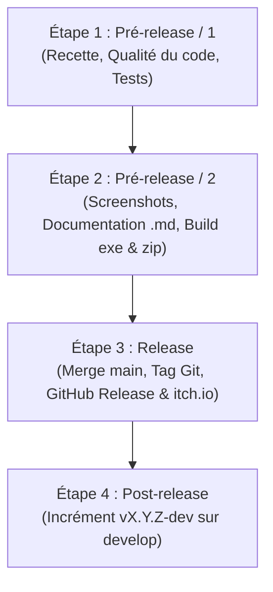

# Protocole de Publication et Release — AMSO

Ce document détaille la procédure standardisée et immuable en 4 étapes pour la publication de chaque nouvelle version d'**Audio Multi-Source Organizer (AMSO)**.

---

## Vue d'ensemble du cycle de release

---

## 🟦 Étape 1 : Pré-release / 1 — Stabilisation & Recette fonctionnelle

> **Objectif :** Valider que le code et toutes les fonctionnalités prévues sont 100 % stables avant d'entamer le packaging.

### Checklist des actions
1. **Relist exhaustif de la release :**
   - Établir la liste des fonctionnalités majeures, améliorations ergonomiques et correctifs de bugs embarqués dans cette version.
2. **Audit qualité du code & outillage :**
   - Linting : `ruff check .`
   - Typage statique : `mypy amso`
   - Complexité et maintenabilité : `radon cc amso`
   - Audit global scripté : `scripts\audit_code_quality.bat`
3. **Tests de non-régression automatisés :**
   - Exécution de toute la suite de tests unitaires : `.venv\Scripts\pytest -q`
   - Zéro test en échec toléré.
4. **Validation manuelle utilisateur (Recette) :**
   - Parcours complet des cas d'usage réels par l'utilisateur (Lecteur audio, Playlist, Jeux / Blind Test, Gestion des sources, Tri et exploration par dossiers).
   
> 🛑 **JALON DE VALIDATION 1 :** Accord explicite de l'utilisateur pour clore les développements de code avant de passer à l'étape suivante.

---

## 🟨 Étape 2 : Pré-release / 2 — Documentation, Visuels & Packaging

> **Objectif :** Préparer tous les livrables finaux (textes, captures, exécutables compilés et archives `.zip`).

### Checklist des actions
1. **Règle des captures d'écran (Screenshots) :**
   - Intégrer les captures spécifiques de la version courante (`screenshots/*vX.Y.Z*.png`).
   - Intégrer les captures transversales / intemporelles (`screenshots/Global*.png`) si existantes.
2. **Passage de version officielle dans le code :**
   - Basculer de `X.Y.Z-dev` vers `X.Y.Z` dans `amso/__init__.py`.
   - Mettre à jour `version` dans `pyproject.toml`.
   - Exécuter la synchronisation des traductions : `python scripts/sync_translations.py`.
3. **Actualisation des 3 fichiers Markdown (FR) :**
   - `CHANGELOG.fr.md` : Clôturer la section `[X.Y.Z-dev]` sous son titre définitif `## [X.Y.Z] - AAAA-MM-JJ`.
   - `README.fr.md` : Mettre à jour le badge de version, les fonctionnalités documentées et les liens d'images (captures `vX.Y.Z` et `Global*`).
   - `ROADMAP.fr.md` : Pointer et cocher les objectifs atteints en vX.Y.Z et réajuster les jalons suivants.
4. **Compilation & Création des archives de distribution :**
   - Lancer la compilation PyInstaller : `python scripts/build_exe.py` (ou `scripts\build_exe.bat`).
   - Préparer le dossier de distribution : `dist/AMSO-Windows-vX.Y.Z/` contenant :
     - Le dossier compilé `AMSO/` (ou l'exécutable portable).
     - Les 3 fichiers Markdown à jour : `README.fr.md`, `CHANGELOG.fr.md`, `ROADMAP.fr.md`.
   - Créer l'archive zip finale : `dist/AMSO-Windows-vX.Y.Z.zip`.
   - *(Note jalon v0.4.0+) :* Extension du packaging multiplateforme via GitHub Actions (`runs-on: [ubuntu-latest, macos-latest]`) pour générer également les paquets Linux (`.AppImage`) et macOS (`.dmg`).
5. **Validation manuelle de l'exécutable :**
   - Tester le lancement de `AMSO.exe` directement depuis le dossier compilé (hors environnement virtuel Python).

> 🛑 **JALON DE VALIDATION 2 :** Validation manuelle du bon fonctionnement de l'exécutable packagé et validation des textes de documentation avant publication.

---

## 🟩 Étape 3 : Release — Publication publique

> **Objectif :** Déployer la version aux utilisateurs et archiver le code source officiel.

### Checklist des actions
1. **Commit & Merge Git :**
   - Commit de release sur la branche active : `git commit -m "chore(release): version vX.Y.Z"`
   - Merge de la branche de dev vers la branche principale : `git checkout main` puis `git merge develop`
   - Création du tag officiel annoté : `git tag -a vX.Y.Z -m "Release vX.Y.Z"`
   - Push vers le dépôt distant : `git push origin main develop --tags`
2. **Publication & Synchronisation GitHub Release (automatisée) :**
   - Exécuter le script dédié : `python scripts/publish_github_release.py` (ou avec `--tag vX.Y.Z`).
   - Le script réalise de façon totalement automatisée :
     - L'extraction intégrale des notes de version depuis `CHANGELOG.fr.md`.
     - L'intégration des captures d'écran de la version courante (`screenshots/*vX.Y.Z*.png`) et globales (`screenshots/Global*.png`).
     - La mise en page du tableau officiel des téléchargements (`AMSO-Windows-vX.Y.Z.zip` et `AMSO.exe`).
     - La création ou la mise à jour de la release via l'API REST GitHub (avec jeton d'authentification récupéré automatiquement).
     - Le téléversement de l'archive binaire `dist/AMSO-Windows-vX.Y.Z.zip`.
3. **Publication sur itch.io (automatisée via GitHub Actions & Butler) :**
   - Le workflow `.github/workflows/release.yml` déploie automatiquement l'archive `AMSO-Windows-vX.Y.Z.zip` sur le canal `arnaudlef97/amso:windows` via **Itch.io Butler** à chaque push de tag `v*`.
   - **Prérequis unique :** configurer le secret GitHub `BUTLER_API_KEY` dans *Settings > Secrets and variables > Actions* avec une clé API générée sur [itch.io API Keys](https://itch.io/user/settings/api-keys).
   - Accéder au tableau de bord itch.io pour ajuster la description, les visuels (`screenshots/`) et publier l'annonce (Devlog) si souhaité.

---

## 🟪 Étape 4 : Post-release — Ouverture du cycle suivant

> **Objectif :** Préparer immédiatement l'environnement de dev pour la prochaine version sans impacter la branche de production.

### Checklist des actions
1. **Basculement vers la version dev suivante :**
   - Revenir sur la branche de développement : `git checkout develop`
   - Incrémenter le numéro de version (ex: `0.2.0` ➔ `0.3.0-dev`) dans `amso/__init__.py`.
   - Créer une nouvelle section en tête du journal : `## [X.Y.Z-dev] - En cours de développement` dans `CHANGELOG.fr.md`.
2. **Nettoyage :**
   - Nettoyer les fichiers intermédiaires de compilation (`build/`, caches pyinstaller).
   - Commit d'ouverture du nouveau cycle : `git commit -m "chore: open development cycle for vX.Y.Z"`
