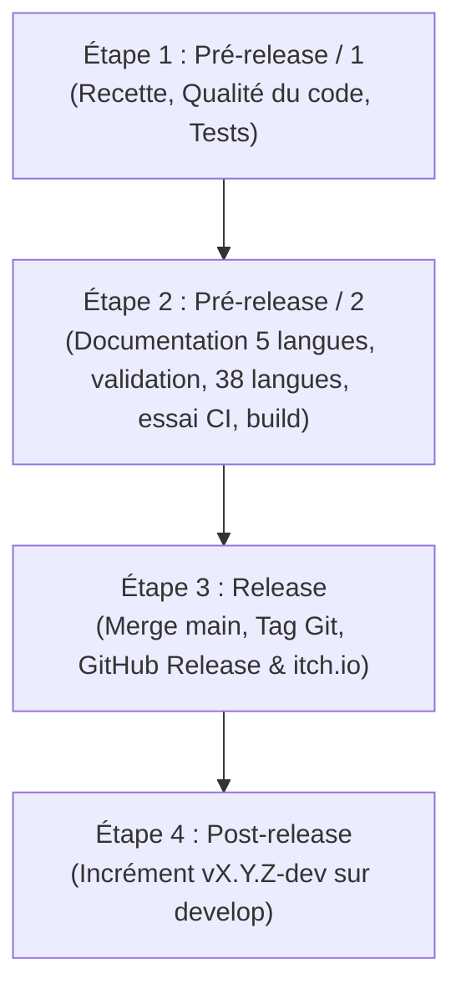

# Protocole de Publication et Release — AMSO

Ce document détaille la procédure standardisée et immuable en 4 étapes pour la publication de chaque nouvelle version d'**Audio Multi-Source Organizer (AMSO)**.

---

## Vue d'ensemble du cycle de release

---

## 🟦 Étape 1 : Pré-release / 1 — Stabilisation & Recette fonctionnelle

> **Objectif :** Valider que le code et toutes les fonctionnalités prévues sont 100 % stables avant d'entamer le packaging.

### Checklist des actions
1. **Relist exhaustif de la release :**
   - Établir la liste des fonctionnalités majeures, améliorations ergonomiques et correctifs de bugs embarqués dans cette version.
2. **Audit qualité du code & outillage :**
   - Linting : `ruff check .`
   - Typage statique : `mypy amso`
   - Complexité et maintenabilité : `radon cc amso`
   - Audit global scripté : `scripts\audit_code_quality.bat`
3. **Tests de non-régression automatisés :**
   - Exécution de toute la suite de tests unitaires : `.venv\Scripts\pytest -q`
   - Zéro test en échec toléré.
4. **Validation manuelle utilisateur (Recette) :**
   - Parcours complet des cas d'usage réels par l'utilisateur (Lecteur audio, Playlist, Jeux / Blind Test, Gestion des sources, Tri et exploration par dossiers).
   
> 🛑 **JALON DE VALIDATION 1 :** Accord explicite de l'utilisateur pour clore les développements de code avant de passer à l'étape suivante.

---

## 🟨 Étape 2 : Pré-release / 2 — Documentation, Visuels & Packaging

> **Objectif :** Préparer tous les livrables finaux (textes, captures, exécutables compilés et archives `.zip`).

### Checklist des actions
1. **Règle des captures d'écran (Screenshots) :**
   - Intégrer les captures spécifiques de la version courante (`screenshots/*vX.Y.Z*.png`).
   - Intégrer les captures transversales / intemporelles (`screenshots/Global*.png`) si existantes.
2. **Passage de version officielle dans le code :**
   - Basculer de `X.Y.Z-dev` vers `X.Y.Z` dans `amso/__init__.py`.
   - Mettre à jour `version` dans `pyproject.toml`.
   - Exécuter la synchronisation des traductions : `python scripts/sync_translations.py`.
3. **Actualisation des fichiers Markdown (FR source, EN par l'assistant, toutes les autres langues par Ollama) :**
   - **Français (source de vérité)** : `CHANGELOG.fr.md` (clôturer `[X.Y.Z-dev]` sous `## [X.Y.Z] - AAAA-MM-JJ`), `README.fr.md` (badges, captures `screenshots/*vX.Y.Z*.png`, texte d'introduction, tableau des fonctionnalités de 13 lignes) et `ROADMAP.fr.md` (cocher `- [x]` les objectifs atteints, réajuster les jalons `- [ ]`).
   - **Anglais** : `CHANGELOG.md`, `README.md`, `ROADMAP.md` traduits depuis le français par l'assistant (seule langue traduite par un assistant).
   - **Espagnol, allemand, italien (CHANGELOG, ROADMAP, README) : Ollama uniquement, jamais de traduction manuelle.** Démarrer Ollama, puis `python scripts/translate_docs.py --ollama --lang es de it` (modèle par défaut `gemma4:latest`). Les blocs déjà traduits sont mémorisés : seuls les blocs modifiés sont retraduits.

> 🛑 **JALON DE VALIDATION 2a :** l'utilisateur relit et valide la documentation dans les 5 langues (fr, en, es, de, it). **Aucune traduction des 38 autres langues n'est lancée avant cet accord explicite.**

   - **Après validation, les 38 autres langues (README) : Ollama uniquement.** `python scripts/translate_docs.py --ollama` (ou `scripts\translate_docs.bat`) traduit le README des 41 langues de `docs/i18n/` ; es, de et it sont déjà à jour grâce au cache. Si le texte français change ensuite, repasser par le jalon 2a.
4. **Vérification automatisée de l'alignement multilingue :**
   - Exécuter le contrôle i18n : `python scripts/sync_translations.py --check-only`
   - Exécuter le contrôle documentaire : `python scripts/check_docs_sync.py --release` (exige en plus les 43 README et un sélecteur de langue à jour)
   - *(Note : la suite de tests automatisée `pytest` et les workflows GitHub Actions bloquent la CI si un seul fichier n'est pas synchronisé).*
5. **Compilation & Création des archives de distribution :**
   - Lancer la compilation PyInstaller : `python scripts/build_exe.py` (ou `scripts\build_exe.bat`).
   - Préparer le dossier de distribution : `dist/AMSO-Windows-vX.Y.Z/` contenant :
     - Le dossier compilé `AMSO/` (ou l'exécutable portable).
     - Les 6 fichiers Markdown de la racine à jour : `README.md`, `README.fr.md`, `CHANGELOG.md`, `CHANGELOG.fr.md`, `ROADMAP.md`, `ROADMAP.fr.md` (le dossier `docs/i18n/` n'est pas dans l'archive : ils sont consultables sur GitHub).
     - Le dossier `locales/` (43 langues) et le fichier `LICENSE`.
   - Créer l'archive zip finale : `dist/AMSO-Windows-vX.Y.Z.zip`.
   - Les paquets Linux (`.tar.gz`, `.AppImage`) et macOS (`.dmg`, Apple Silicon et Intel) sont produits par les jobs `build-linux` et `build-macos` de `.github/workflows/release.yml` (script `scripts/package_unix.py`). Tant qu'ils n'ont pas été testés sur de vrais systèmes, la release les annonce comme **expérimentaux, non testés** (VLC requis, `.dmg` non signé).
6. **Essai à blanc de la CI avant le tag :**
   - Pousser `develop` (le workflow `tests.yml` s'exécute sur Linux, Windows et macOS), puis lancer à la main `release.yml` sur `develop` (onglet Actions, « Run workflow »). Sans tag, rien n'est publié : ni release GitHub, ni itch.io. Les paquets sont téléchargeables en pièces jointes de l'exécution (`AMSO-Linux`, `AMSO-macOS-arm64`, `AMSO-macOS-x86_64`).
   - Corriger les jobs en échec et relancer jusqu'à ce que les trois systèmes réussissent.
7. **Validation manuelle de l'exécutable :**
   - Tester le lancement de `AMSO.exe` directement depuis le dossier compilé (hors environnement virtuel Python).

> 🛑 **JALON DE VALIDATION 2b :** Validation manuelle du bon fonctionnement de l'exécutable packagé (et, si possible, des paquets Linux et macOS) avant publication.

---

## 🟩 Étape 3 : Release — Publication publique

> **Objectif :** Déployer la version aux utilisateurs et archiver le code source officiel.

### Checklist des actions
1. **Commit & Merge Git :**
   - Commit de release sur la branche active : `git commit -m "chore(release): version vX.Y.Z"`
   - Merge de la branche de dev vers la branche principale : `git checkout main` puis `git merge develop`
   - Création du tag officiel annoté : `git tag -a vX.Y.Z -m "Release vX.Y.Z"`
   - Push vers le dépôt distant : `git push origin main develop --tags`
2. **Publication & Synchronisation GitHub Release (automatisée) :**
   - Exécuter le script dédié : `python scripts/publish_github_release.py` (ou avec `--tag vX.Y.Z`).
   - Le script réalise de façon totalement automatisée :
     - L'extraction intégrale des notes de version depuis `CHANGELOG.fr.md`.
     - L'intégration des captures d'écran de la version courante (`screenshots/*vX.Y.Z*.png`) et globales (`screenshots/Global*.png`).
     - La mise en page du tableau officiel des téléchargements (`AMSO-Windows-vX.Y.Z.zip` et `AMSO.exe`).
     - La création ou la mise à jour de la release via l'API REST GitHub (avec jeton d'authentification récupéré automatiquement).
     - Le téléversement de l'archive binaire `dist/AMSO-Windows-vX.Y.Z.zip`.
3. **Publication sur itch.io (automatisée via GitHub Actions & Butler) :**
   - Le workflow `.github/workflows/release.yml` déploie automatiquement l'archive sur le canal `arnaudlef97/amso:windows` via **Itch.io Butler** à chaque push de tag `v*` uniquement : un déclenchement manuel (`workflow_dispatch`) construit les paquets mais ne publie rien.
   - **Nommage des fichiers Itch.io :**
     - Butler nomme automatiquement le fichier généré selon le projet et le canal : `amso-windows.zip` avec le tag officiel vert `[windows]`.
     - L'intitulé lisible (*« Nom affiché »*) personnalisé sur Itch.io (ex: `AMSO — Windows (Portable 64-bit)`) est pérenne et automatiquement conservé par Itch.io à chaque nouvelle version poussée par Butler.
     - Les anciens fichiers d'archives ou exécutables résiduels antérieurs doivent être supprimés du tableau de bord Itch.io (*Fichiers mis en ligne*) pour éviter tout téléchargement d'une version obsolète.
   - **Publication du Devlog bilingue (FR / EN) :**
     - À chaque publication, l'assistant DOIT obligatoirement générer et fournir à l'utilisateur le titre et le contenu complet du **Devlog officiel en français et en anglais**, prêt à être publié sur Itch.io pour notifier la communauté et faire remonter l'application dans le flux d'actualités.

---

## 🟪 Étape 4 : Post-release — Ouverture du cycle suivant

> **Objectif :** Préparer immédiatement l'environnement de dev pour la prochaine version sans impacter la branche de production.

### Checklist des actions
1. **Basculement vers la version dev suivante :**
   - Revenir sur la branche de développement : `git checkout develop`
   - Incrémenter le numéro de version (ex: `0.3.0` ➔ `0.4.0-dev`) dans `amso/__init__.py`.
   - Créer une nouvelle section en tête de journal dans `CHANGELOG.fr.md` (les autres langues suivent à la prochaine traduction) :
     - `CHANGELOG.fr.md` : `## [X.Y.Z-dev] - En cours de développement`
     - `CHANGELOG.md` : `## [X.Y.Z-dev] - In Development`
     - `CHANGELOG.es.md` : `## [X.Y.Z-dev] - En desarrollo`
     - `CHANGELOG.de.md` : `## [X.Y.Z-dev] - In Entwicklung`
     - `CHANGELOG.it.md` : `## [X.Y.Z-dev] - In sviluppo`
   - Valider la synchronisation : `python scripts/check_docs_sync.py`
2. **Nettoyage :**
   - Nettoyer les fichiers intermédiaires de compilation (`build/`, caches pyinstaller).
   - Commit d'ouverture du nouveau cycle : `git commit -m "chore: open development cycle for vX.Y.Z"`
